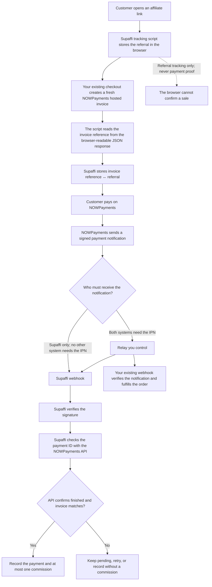
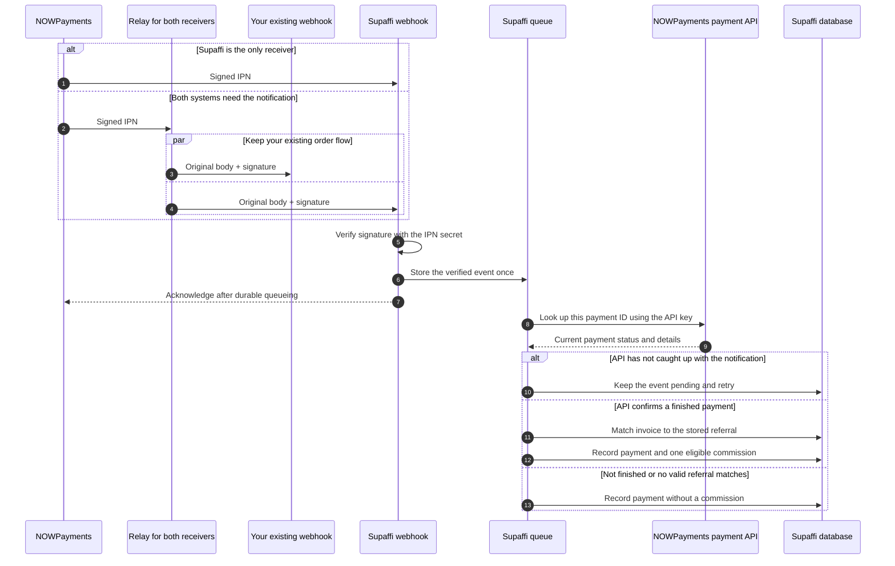

# How NOWPayments works with Supaffi

Supaffi connects an affiliate referral to a NOWPayments invoice, then verifies
the payment with NOWPayments before recording a commission. Your site keeps its
checkout, payment handling, and fulfillment.

> **If your app relies on its current NOWPayments webhook to confirm orders or
> fulfill them, keep that webhook connected.** Route the notification through
> the relay so both your app and Supaffi receive it. Send callbacks only to
> Supaffi when it is intentionally the sole receiver and no other system needs
> that notification.

## The whole flow



**The key distinction:** the browser identifies the referral associated with an
invoice. The signed notification and a server-to-server NOWPayments API check
prove the payment. Supaffi creates a commission only after both sides match.

## 1. Before payment: link an invoice to a referral

```mermaid
sequenceDiagram
  autonumber
  actor Customer
  participant Site as Your site checkout code
  participant Tracker as Supaffi tracking script
  participant Supaffi as Supaffi tracking endpoint
  participant NOW as NOWPayments
  participant DB as Supaffi database

  Customer->>Site: Open affiliate link
  Site-->>Customer: Load page with the Supaffi script
  Tracker->>Tracker: Save the referral token in the browser
  Customer->>Site: Start checkout
  Site->>Tracker: fetch request to create a fresh hosted invoice
  Tracker->>NOW: Forward the original request
  NOW-->>Tracker: Return invoice URL in JSON
  Note over Tracker: Inspect a clone of the response; the original stays intact
  Tracker->>Supaffi: Register invoice reference + referral token
  Supaffi->>DB: Save the invoice-to-referral link once
  Tracker-->>Site: Return the original response (up to 800 ms for registration)
  Site-->>Customer: Continue to the hosted invoice
```

The tracker watches successful browser `fetch` responses and recognizes the
NOWPayments hosted invoice URL. It registers the invoice reference before
returning the original, unchanged response to your checkout code. It waits up to
800 ms for registration, then lets checkout continue even if Supaffi is
unavailable. That invoice may then be unattributed. The tracker never says
whether the customer paid.

Automatic capture requires a **new invoice for each sale** and a JSON response
that the browser can read. A cross-origin response must allow browser access
through CORS. Reused invoice links, split payments, XHR, and other response
formats are not captured automatically.

## 2. After payment: verify it before counting a sale

NOWPayments sends a signed IPN (payment notification) to the callback URL set
for the invoice or payment. Send it directly to Supaffi only when it is the sole
receiver and no existing order or fulfillment flow depends on another webhook.
If your existing webhook must also receive the IPN, route it through the relay
you control. The relay forwards the original request body and signature to
both; it does not decide whether a payment is valid.



Supaffi checks the notification signature, then asks NOWPayments about the exact
payment ID from that notification. The amount and currency must match the
signed notification; invoice and order IDs are compared when both the
notification and API provide comparable values. Supaffi then matches the
verified invoice reference to the referral it stored before payment. The API
status must not lag behind the notification, and it must confirm `finished`
before Supaffi can create a commission. A stale API response is retried rather
than treated as a completed payment. A customer returning to the site, a
browser event, or an unverified notification cannot create a sale.

The invoice-to-referral association is unique and cannot be reassigned to a
different affiliate. Provider events and payments are deduplicated, so retries
cannot count the same payment twice. A commission requires an API-confirmed
`finished` status and a valid referral for that invoice within the referral's
attribution window. Other payment statuses can be stored without earning a
commission.

## What each part needs

| Part | Responsibility | Credentials or access |
| --- | --- | --- |
| Tracking script | Connect the browser's referral to a fresh invoice reference | No merchant credentials |
| Supaffi | Verify the notification, check payment facts, and calculate a commission | NOWPayments API key and IPN secret |
| Relay, when your existing webhook also needs the IPN | Forward one signed notification to Supaffi and your existing webhook | The two receiver URLs; no NOWPayments credentials |
| Your existing webhook | Continue your current order and fulfillment flow | Its existing configuration |

Supaffi encrypts its API key and IPN secret at rest. It does not need your
application credentials, database access, account password, or fulfillment
code. Each webhook receiver verifies the original provider signature itself.

Use the relay whenever your existing webhook must continue receiving the same
notification as Supaffi. The [relay guide](../integrations/nowpayments-webhook-relay/README.md)
shows how to deploy it in infrastructure you control. If either receiver is
unavailable, the relay returns a failure so NOWPayments can retry delivery.

## Setup at a glance

1. In the product's **Settings → Connections**, save the NOWPayments API key and
   IPN secret. Supaffi uses the API key to check a payment ID and the IPN secret
   to verify signatures. Supaffi does not use payout endpoints.
2. Add the Supaffi tracking script to pages where an affiliate link can land.
   Confirm that the checkout's fresh invoice response is readable to the
   browser and that the invoice gets registered.
3. Use the HTTPS receiver URL shown in Supaffi only if no other system needs the
   IPN. If your existing webhook handles orders or fulfillment, set the
   callback to your relay and configure both receiver URLs. When checkout
   supplies `ipn_callback_url` for each invoice, point that existing setting at
   the relay; see the [relay guide](../integrations/nowpayments-webhook-relay/README.md).
4. Complete a test payment and confirm that every intended receiver gets the
   notification. Confirm that Supaffi verifies the payment before showing a
   commission.

See [Payment providers](payment-providers.md) for supported statuses and
integration limits.

NOWPayments references: [IPN callbacks](https://nowpayments.io/help/what-is/what-is-ipn)
and [Payments API](https://nowpayments.io/api).
