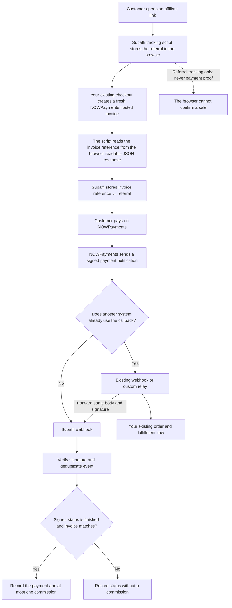
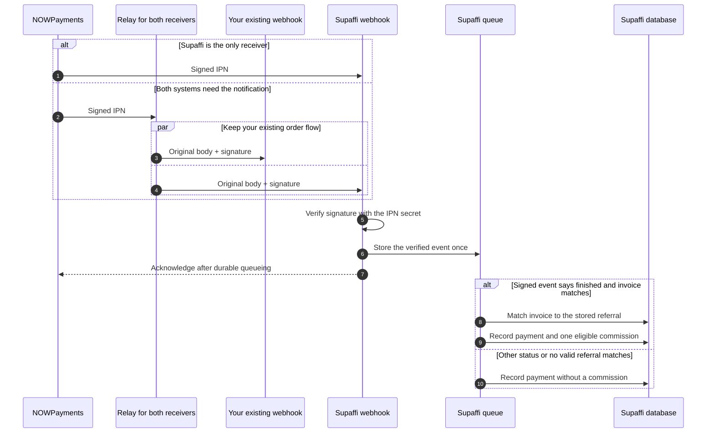

# How NOWPayments works with Supaffi

Supaffi connects an affiliate referral to a NOWPayments invoice. When NOWPayments
sends a signed payment notification, Supaffi verifies it with the IPN secret and
records a commission only for a `finished` payment. Your site keeps its checkout,
payment handling, and fulfillment.

> **If your app relies on its current NOWPayments webhook to confirm orders or
> fulfill them, keep that webhook connected.** NOWPayments sends an IPN to one
> callback destination. Add a custom relay that forwards the original request
> body and `x-nowpayments-sig` header to Supaffi. Do not replace your existing
> callback with Supaffi's URL unless Supaffi is the only receiver.

## The whole flow



**The key distinction:** the browser identifies the referral associated with an
invoice. A signed NOWPayments IPN is the payment confirmation. Supaffi checks its
signature, status, and invoice reference before creating a commission. The
browser never reports payment success.

## 1. Before payment: link an invoice to a referral

```mermaid
sequenceDiagram
  autonumber
  actor Customer
  participant Site as Your site checkout code
  participant Tracker as Supaffi tracking script
  participant Supaffi as Supaffi tracking endpoint
  participant NOW as NOWPayments
  participant DB as Supaffi database

  Customer->>Site: Open affiliate link
  Site-->>Customer: Load page with the Supaffi script
  Tracker->>Tracker: Save the referral token in the browser
  Customer->>Site: Start checkout
  Site->>Tracker: fetch request to create a fresh hosted invoice
  Tracker->>NOW: Forward the original request
  NOW-->>Tracker: Return invoice URL in JSON
  Note over Tracker: Inspect a clone of the response; the original stays intact
  Tracker->>Supaffi: Register invoice reference + referral token
  Supaffi->>DB: Save the invoice-to-referral link once
  Tracker-->>Site: Return the original response (up to 800 ms for registration)
  Site-->>Customer: Continue to the hosted invoice
```

The tracker watches successful browser `fetch` responses and recognizes the
NOWPayments hosted invoice URL. It registers the invoice reference before
returning the original, unchanged response to your checkout code. It waits up to
800 ms for registration, then lets checkout continue even if Supaffi is
unavailable. That invoice may then be unattributed. The tracker never says
whether the customer paid.

Automatic capture requires a **new invoice for each sale** and a JSON response
that the browser can read. A cross-origin response must allow browser access
through CORS. Reused invoice links, split payments, XHR, and other response
formats are not captured automatically.

## 2. After payment: verify it before counting a sale

NOWPayments sends a signed IPN (payment notification) to one callback URL. If
your app already uses that callback for orders or fulfillment, keep it and add a
custom relay in the existing handler or in infrastructure you control. It must
forward the original POST body and `x-nowpayments-sig` header to Supaffi. If no
other system needs the notification, you can use the Supaffi URL directly.



Supaffi checks the HMAC-SHA-512 signature against the exact notification data
using the saved IPN secret, then queues the event for processing. The signed
payload contains the payment ID, status, invoice ID, amount, and currency. The
queue matches the invoice ID to the referral recorded before checkout. A
customer returning to the site, a browser event, or a notification with an
invalid signature cannot create a sale.

The invoice-to-referral association is unique and cannot be reassigned to a
different affiliate. Provider events and payments are deduplicated, so retries
cannot count the same payment twice. A commission requires a signed `finished`
status and a valid referral for that invoice within the referral's attribution
window. Other payment statuses can be stored without earning a commission.

## What each part needs

| Part | Responsibility | Credentials or access |
| --- | --- | --- |
| Tracking script | Connect the browser's referral to a fresh invoice reference | No merchant credentials |
| Supaffi | Verify the notification and calculate a commission | NOWPayments IPN secret only |
| Relay, when your existing webhook also needs the IPN | Forward one signed notification to Supaffi and your existing webhook | The two receiver URLs; no NOWPayments credentials |
| Your existing webhook | Continue your current order and fulfillment flow | Its existing configuration |

Supaffi encrypts the IPN secret at rest. It does not need your NOWPayments API
key, application credentials, database access, account password, or fulfillment
code. Your app can keep its API key for invoice creation. Each webhook receiver
verifies the original provider signature itself.

Use a custom relay whenever your existing webhook must continue receiving the
same notification as Supaffi. The [relay guide](../integrations/nowpayments-webhook-relay/README.md)
shows how to deploy one in infrastructure you control. If either receiver is
unavailable, the relay returns a failure so NOWPayments can retry delivery.

## Setup at a glance

1. In the product's **Settings → Connections**, save the NOWPayments IPN secret.
   Supaffi uses it to verify signatures and does not need the API key, account
   password, or payout access.
2. Add the Supaffi tracking script to pages where an affiliate link can land.
   Confirm that the checkout's fresh invoice response is readable to the
   browser and that the invoice gets registered.
3. Copy the HTTPS receiver URL shown in Supaffi. If your app already uses the
   callback, keep it and configure a custom relay to forward the unchanged body
   and signature header to Supaffi. If the app has no existing callback, set the
   Supaffi URL directly in NOWPayments. For a standalone relay, point NOWPayments
   at the relay and configure both destinations; see the [relay guide](../integrations/nowpayments-webhook-relay/README.md).
4. Complete a test payment and confirm that every intended receiver gets the
   notification. Supaffi should show a commission only after a valid signed
   `finished` event matches the saved invoice attribution.

See [Payment providers](payment-providers.md) for supported statuses and
integration limits.

## Adversarial checks

The NOWPayments test suite includes repeatable adversarial cases in addition
to ordinary examples. A seeded generator reorders nested JSON keys and varies
valid payment values; mutation and fuzz cases alter signed payloads, feed
malformed JSON, and check that the receiver rejects invalid signatures and
amounts without throwing or queueing an event. Boundary cases cover body size,
UTF-8, the database's monetary precision, duplicate callbacks, and missing
provider timestamps. A sale amount whose raw decimal differs from the number
covered by the HMAC is rejected. If an optional crypto amount contains extra
precision the signature cannot distinguish, Supaffi records it as unavailable;
other raw numeric values are normalized to their signed value. A payment
without a trustworthy provider timestamp can still be recorded, but it cannot
earn an affiliate commission.

Run the fast parser and receiver checks with:

```sh
pnpm exec vitest run test/lib/payments/nowpaymentsAdversarial.test.ts test/app/api/webhooks/nowpayments/route.test.ts
```

The worker attribution suite exercises payment deduplication and commission
creation against the isolated `_test` database:

```sh
pnpm exec vitest run test/lib/worker/nowpaymentsAttribution.test.ts
```

CI runs these as part of the complete `pnpm test` suite.

NOWPayments reference: [IPN callbacks](https://nowpayments.io/help/what-is/what-is-ipn).
