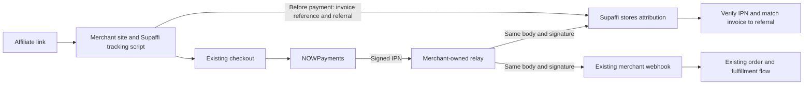

# Payment providers

Supaffi supports Stripe and NOWPayments. Stripe setup and payment handling remain provider-specific. For NOWPayments, a merchant keeps its existing checkout, API key, webhook handler, and fulfillment. A small relay deployed in the merchant's own infrastructure copies each signed provider notification to the existing webhook and Supaffi.

| Provider | Supported path | Recurring commissions | Refunds and disputes |
| --- | --- | --- | --- |
| Stripe | Stripe Checkout, Payment Links, buy buttons and pricing tables | Yes, for subscriptions created through those checkout paths | Stripe refunds and disputes are processed from signed events |
| NOWPayments | One fresh hosted invoice per sale, paid once, with its signed IPN delivered through a merchant-owned relay | No | A `refunded` notification voids an unpaid commission; disputes are not supported |

Supaffi records affiliate payouts but does not send them. NOWPayments does not pay affiliates in cryptocurrency and does not support subscription commissions. Other payment providers and direct uploads of provider exports are not supported by this release.

## NOWPayments without backend code changes



The browser registers only which referral belongs to a newly created hosted invoice. It does not report payment success. Supaffi creates a commission only after receiving and verifying a NOWPayments IPN for that invoice. The existing merchant webhook still receives the same provider body and signature, so its payment and fulfillment logic remains in control. Supaffi never calls the merchant application.

1. In the product's **Settings → Connections**, save the NOWPayments IPN secret. Supaffi encrypts it in the database with AES-256-GCM using the instance's `MASTER_ENCRYPTION_KEY`; it is not shown again. Supaffi does not need the NOWPayments API key.
2. Add the Supaffi tracking script to the merchant site. Each sale must use a fresh NOWPayments hosted invoice and one payment ID. Automatic capture supports successful `fetch` POST requests that return the standard invoice URL in JSON. This includes same-origin requests and cross-origin requests whose response the browser allows the merchant page to read through CORS. The script reads the existing referral cookie, extracts the invoice reference, and gives Supaffi up to 800 ms to register the association before returning the response to the merchant code. Reusable invoice links, split payments, XHR, unreadable cross-origin responses, and other response shapes are not supported. If the tracker cannot identify the reference or Supaffi does not respond in time, checkout continues; that order may not be attributed.
3. Deploy the [merchant-owned webhook relay](../integrations/nowpayments-webhook-relay/README.md) in infrastructure controlled by the merchant. Configure `EXISTING_WEBHOOK_URL` with the current merchant webhook and `SUPAFFI_WEBHOOK_URL` with the receiver URL shown in Supaffi settings.
4. Route NOWPayments IPNs through the relay. Change the existing callback destination setting to the relay URL, or place the relay in front of the existing callback address. This is callback routing configuration; it does not require a change to checkout or webhook code.
5. The relay forwards the original request body and `x-nowpayments-sig` unchanged to both destinations. Supaffi verifies the provider's HMAC-SHA-512 with the saved IPN secret; the merchant's existing webhook continues its own verification and order handling.

The Supaffi receiver URL uses the instance's public `SUPAFFI_DOMAIN` and has this form:

```text
https://supaffi.example.test/api/webhooks/nowpayments/<opaque-route-id>
```

NOWPayments documents a callback URL for an invoice or payment and does not document multiple destinations. The relay provides the fan-out while preserving the existing webhook. If either receiver is unavailable, the relay responds with a failure so the provider can retry. Duplicate notifications remain safe because each destination handles event identity idempotently.

## NOWPayments notification statuses

Supaffi currently accepts these exact lowercase `payment_status` values:

| NOWPayments status | Supaffi result |
| --- | --- |
| `waiting` | Pending; no commission |
| `confirming` | Pending; no commission |
| `confirmed` | Pending; no commission |
| `sending` | Pending; no commission |
| `partially_paid` | Pending; no commission |
| `finished` | Successful payment; can create a commission when the verified invoice reference matches a valid referral |
| `failed` | Failed payment; no commission |
| `expired` | Failed payment; no commission |
| `refunded` | Refunded payment; voids an unpaid commission |

The sale amount and currency come from the verified NOWPayments notification. Statuses are applied monotonically for the same payment: a `finished` state is not regressed by a late pending, failed, or expired notification, and `refunded` remains final. A refund does not reverse a payout already recorded.

A signed payment notification without `invoice_id` is stored as an unattributed payment and does not earn a commission. Supaffi does not use the optional merchant `order_id` as a substitute for the invoice reference. If an invoice is reused, only the first completed payment can receive attribution; later payments are retained without a commission.

Supaffi acknowledges a valid notification after it has durably queued it; this acknowledgement does not mean commission processing has finished. Duplicate notifications are acknowledged without queueing a second operation. If worker processing fails, Supaffi retries with exponential backoff from 30 seconds up to four hours, for at most 20 attempts (about two days). Failed events remain for operator review in the server logs/database.

## Moving from another commission writer

Use a provider-neutral cutover for each product:

1. Preview and reconcile affiliate, referral, commission, and payout history in Supaffi before changing production. Review the import report and resolve row conflicts.
2. Test the existing checkout and merchant-owned relay on an isolated product or test flow. Confirm that Supaffi receives a successful payment notification and attributes a referred order to the expected affiliate.
3. Cut over production atomically: disable the previous commission writer before or at the same time as enabling Supaffi to process new production payments. Do not let both writers process the same sale.

See the [affiliate import format](affiliate-import-format.md) for the supported canonical import bundle.
